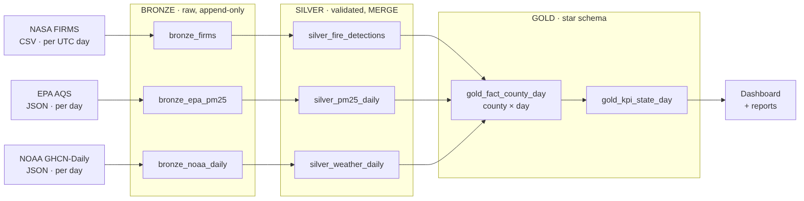

# California Wildfire Smoke Data Pipeline – Final Report
Group 8: Nikhil Sai Viswajith, Nino Pelko, Nithish Balasubramanian, Ragavedhni Kuppa Ramesh

> Fill every `[FILL: …]` with a number or output from **your own Databricks runs** (tables `dq_summary`, `bench_results`,
> `ops_step_log`, `gold_*`). Delete this note before submitting.

## 1 Abstract (≈150 words)
We built a reproducible PySpark/Delta Lake pipeline on Databricks Free Edition that integrates NASA FIRMS fire detections,
EPA AQS PM2.5 and NOAA GHCN-Daily weather for California, 15 Aug – 30 Sep 2020, into a county-day Gold table.
The pipeline processed [FILL: total Bronze rows] raw records in [FILL: n] daily batches; [FILL: %] passed validation.
Rerunning identical batches changed 0 Gold rows, and a simulated late EPA correction changed exactly [FILL: 1] county-day.
[FILL: one sentence on CSV vs API result]. [FILL: one sentence on the main analytical finding].

## 2 Motivation and research questions
(Reuse proposal §2 and §4.1, shortened.)

## 3 Architecture

* Bronze: raw strings + metadata, append-only, file manifest with SHA-256 (skips reloads, detects revisions).
* Silver: type casting, UTC → local date, validation with quarantine, business-key dedup, Delta MERGE, nearest-county lookup.
* Gold: `gold_fact_county_day` (58 counties × [FILL: days] days = [FILL: rows] rows), `gold_dim_county`, `gold_dim_date`, `gold_kpi_state_day`.
* Data contract and rules: `docs/data_contract.md`.

## 4 Data
| Source | Files | Bronze rows | Size (MB) | Silver rows |
| --- | --- | --- | --- | --- |
| NASA FIRMS | [FILL] | [FILL] | [FILL] | [FILL] |
| EPA AQS | [FILL] | [FILL] | [FILL] | [FILL] |
| NOAA GHCN-Daily | [FILL] | [FILL] | [FILL] | [FILL] |

## 5 Results
### 5.1 RQ1 – Can the sources be integrated into one analytical table?
[FILL: yes/no + Gold row count, % county-days with PM2.5, % with weather, sample correctness check from 05_data_quality: 5/5 matched?]

### 5.2 RQ2 – CSV vs API
| Test | Rows | Median s | Min s | Max s |
| --- | --- | --- | --- | --- |
| raw_csv_bulk | [FILL] | [FILL] | [FILL] | [FILL] |
| raw_json_api | [FILL] | [FILL] | [FILL] | [FILL] |
| delta_query_from_csv | [FILL] | [FILL] | [FILL] | [FILL] |
| delta_query_from_json | [FILL] | [FILL] | [FILL] | [FILL] |

Interpretation: [FILL: e.g. reading the bulk CSV scans the whole-US file; JSON needs multiLine parsing and explode; once in Delta both query the same. Download time from the API (5 s pause per call) vs one bulk download.]

### 5.3 RQ3 – Incremental reruns and late data
* Rerun of identical files: Bronze skipped [FILL] files; Gold MERGE inserted 0 / updated 0 (paste `DESCRIBE HISTORY` metrics).
* Late correction: [FILL: county, date, old → new PM2.5]; Gold rows changed: [FILL: 1].
* Daily replay: each new day added [FILL: 58] Gold rows and rebuilt only that date.

### 5.4 Where the time goes
[FILL: table or chart from `ops_step_log`: step, rows, avg seconds; name the heaviest step and why (e.g. county cross-join, MERGE).]

### 5.5 Analytical check (sample report)
[FILL: chart of statewide fire FRP vs average county PM2.5 (dashboard tile 1); top counties by days over 35 µg/m³; correlations same-day vs previous-day (tile 6).]

## 6 Data quality
Summary of `docs/data_quality_report.md`: pass rate per source, top quarantine reasons, duplicates removed, null rates, unmatched identifiers.

## 7 Limitations
* Nearest-centroid county assignment (approximate near borders; [FILL: n] detections > 60 km from their centre).
* Sparse PM2.5 monitoring: [FILL: %] of county-days have no PM2.5.
* Smoke indicator is descriptive, not causal or regulatory.
* Historical replay, not live streaming; Free Edition compute quotas limited sample size.

## 8 Lessons learned and future work
[FILL: 3–5 bullets, e.g. EPA duplicates per pollutant standard; UTC vs local date; polygon join with a geometry library; Auto Loader; HMS smoke plumes.]

## 9 Contributions
| Member | Contribution |
| --- | --- |
| Nikhil Sai Viswajith | [FILL] |
| Nino Pelko | [FILL] |
| Nithish Balasubramanian | [FILL] |
| Ragavedhni Kuppa Ramesh | [FILL] |

## AI disclosure
[FILL: state which parts were drafted with which AI tools, and that the team reviewed and ran the code.]

## References
Keep the proposal references, plus the data sources in `docs/data_contract.md`.
